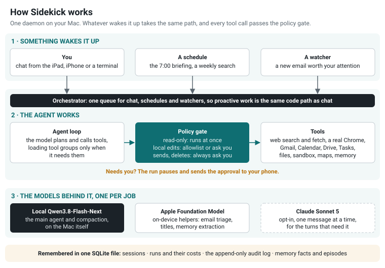
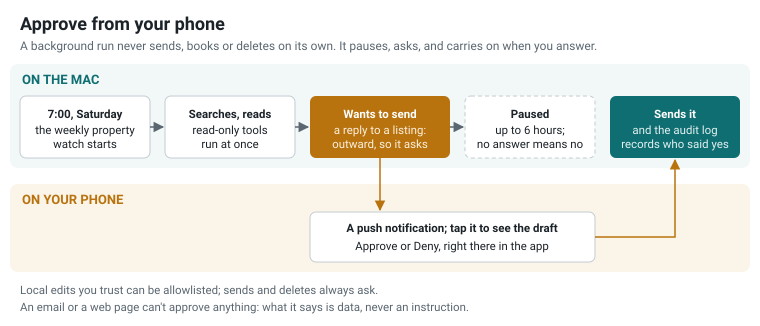

# Sidekick

**Your own AI assistant, on your own Mac. It works while you sleep, remembers what matters to you,
and asks your phone before it sends, books or deletes anything.**

Sidekick is a personal AI assistant that does real jobs, not just chat. Every week it combs the
property sites, reads the new listings properly and leaves a short report. It plans a holiday, keeps
the itinerary in your calendar and watches your inbox for changes. It finds a restaurant table and
drives the booking site in a real Chrome. It reads a stack of contracts and statements and tells you
what differs. And it says good morning by name.

Talk to it from an iPad, an iPhone or a terminal, or leave it alone. A schedule or a new email wakes
it, and it gets on with the job: web search, a real browser, Gmail and Calendar, files, maps and
photos. Every tool call passes a policy gate. Reading runs on its own; anything that sends, books or
deletes waits for a tap on your phone. It remembers what it learns about you, so it gets more useful
the more you use it.

It runs on your Mac, on a local model: Qwen3.8-Flash-Next on
[Flash-Next SSD](https://github.com/skeggsguy/Flash-next-ssd). Sidekick loads tools only when a task
needs them and keeps its prompt steady, so a local model can carry long jobs. My last month of it
cost $0.68 in cloud fees. When a turn needs more, Claude Sonnet is one pick away in the chat, and
it's the one I recommend.

It's the assistant I run every day, published as it is. It was built almost entirely with
[Claude Code](https://claude.com/claude-code), and the files that built it are in the repo
([How it's built](#how-its-built)).

<p align="center"></p>

## Headline numbers

Five months on my Mac mini, 12 June to 1 November 2026. Every run and every tool call is logged as it
happens; `uv run harness runs summary` shows yours.

| | |
|---|---|
| **Works while you sleep** | **672** background runs, started by a schedule, an email or a task it handed off, on 142 of 143 days; 230 of them between 10 pm and 7 am |
| **Gets on with it** | **598 of 623** finished background runs needed nothing from me |
| **Long jobs** | **1 h 35 min** and 50 tool calls in the longest scheduled run that finished; 80 min and 52 calls on the local model |
| **Asks before it acts** | **0** sends, invites, browser tasks or deletes on its own: 123 asked first, 113 approved, 10 refused |
| **Costs almost nothing** | **$0.68** in cloud fees since 2 October, across 641 runs; the Mac read 85M tokens at no charge |
| **Remembers you** | **107** facts and 1,106 conversation summaries; 99 of those facts were pulled into a conversation in the last month |
| **Every call gated** | **9,753** tool calls through the policy gate: 8,619 ran on their own, 1,064 I approved, 70 I refused |

"Asks before it acts" counts every send, calendar invite, browser task and delete. A browser task is
approved once, for one site and a set number of actions; inside it, clicks and typing run on their
own, and anything off that site or past the budget asks again.

## What it does

### Chat and search

Ask anything, from the iPad or iPhone (an installable web app with push notifications), or from a
terminal. It answers with live web search ([Brave](https://brave.com/search/api/)), reads pages, and
falls back to a real Chrome when a site needs JavaScript. It reads and writes your Gmail, Calendar,
Drive and Tasks, and it can see photos you attach. Dictation runs locally with Whisper, so your voice
never leaves the Mac. Weather, maps, RSS, Hacker News and Reddit are built in.

### A memory that grows as you use it

After each conversation, an on-device model picks out what's worth keeping: preferences, people,
facts about your life, and what worked last time on a hard task. Each new chat starts with what's
relevant, and the agent can search the rest (`recall`). Vector search runs locally through Ollama;
without it, recall falls back to keyword search. A clean-up job proposes what to merge or forget, and
changes nothing until you approve.

### Long-running jobs that ask before they act

A scheduled job is a written brief (a playbook) plus a schedule and the tools it may use. It runs on
its own: it can search, read and compare for hours. When it wants to do something that leaves the
Mac, it stops and asks.

<p align="center"></p>

The run waits while you decide (up to 6 hours for anything outward), then carries on with your
answer.

### A real browser

Some sites only work in a browser. `browser_fetch` reads them through a persistent Chrome, and
`browser_delegate` hands a task to a browser sub-agent that clicks, types and fills forms. You approve
the task once, for one site and a set number of actions. Inside that, it works on its own; going off
the site or past the budget asks again, naming the element and the site. All of its traffic goes through a local
egress proxy that refuses private network addresses.

### Pictures

Attach a photo in chat and the local model looks at it itself: Qwen3.8-Flash-Next reads images
natively. A photo counts as untrusted data like any web page: text in it is never an instruction.

### Schedules

Cron schedules, set up in the web app or simply by asking ("every weekday at 7, brief me"). The
built-in playbooks: a morning briefing (calendar, email, tasks, news), email triage, a weekly cost
report, memory clean-up, and a check of how well approval prediction is doing. If the Mac was asleep,
missed runs catch up when it wakes.

### Built for a local model

A local model has a limited context and reads every token of the prompt itself, so Sidekick spends
tokens carefully:

- **Tools on demand (progressive disclosure).** The agent starts with the everyday tools, and the
  rest (about 40 Google Workspace tools, files, the browser, schedules) sit in groups it loads only
  when a task needs them. Without that, every tool definition would ride along in every request.
- **A prompt that stays the same,** so the model server can reuse its cache of the prompt's opening
  instead of reading it again on every turn.
- **Compaction.** When a conversation grows long, the older middle is summarised and the recent turns
  stay word for word. The summary is saved as a checkpoint, so a restart carries on from it.

### A security model you can read

Every tool declares what kind of action it is, and every run has an autonomy level. The policy gate
combines the two:

| Action class | Example | What happens |
|---|---|---|
| Read-only | search, read an email | runs at once |
| Changes something local | edit a file in the work area | allowlist, or ask you |
| Outward | send an email, start a browser task | always asks you; can never be allowlisted. A browser task asks once, for one site and a set number of actions |
| Destructive | delete, trash | always asks you, and is refused outright in unattended runs |

On top of that: anything Sidekick reads (emails, web pages, files, photos) is data, never
instructions, and never reaches the system prompt. Model-written code runs in a Docker sandbox. Every
decision goes into an append-only audit log. Secrets stay in `.env`. The rules live in one file:
[`src/harness/core/policy.py`](src/harness/core/policy.py).

## Dogfooded on

Real jobs, run for months:

- **A weekly property watch.** It searches the listing sites, reads the new listings properly
  (floor plans, prices, what changed since last week) and sends a short report. A reply to a listing
  waits for my OK.
- **Restaurant bookings.** It finds a table and drives the booking site in Chrome. I approve the
  task on the phone first: that one site, a set number of clicks.
- **Holiday planning and management.** It researches options, builds the itinerary, keeps it in the
  calendar, and watches the inbox for changes along the way.
- **High-volume document work.** Contracts, statements and PDFs, read and compared in batches.
- **Every day:** the morning briefing, email triage that only pings for what matters, and the weekly
  cost report.

## Choose your models

Each job has its own model, chosen in your settings. There is no silent fallback: if a model isn't
there, Sidekick says so.

| Job | What I use | What else works | Recommendation |
|---|---|---|---|
| **The main agent** (chat, background runs) and compaction | Qwen3.8-Flash-Next, local, on [Flash-Next SSD](https://github.com/skeggsguy/Flash-next-ssd) | Any server that speaks Anthropic's `/v1/messages`, named by `HARNESS_LOCAL_URL` | Flash-Next SSD on a 64 GB Mac: it runs a 111 GB model at about 29 tokens/s |
| **The helpers:** email triage, chat titles, approval prediction, memory extraction | Apple's on-device Foundation Model (macOS 26+) | Turn it off with `HARNESS_APPLE_FM=off` | Leave it on: free, private and fast |
| **Memory search** | Ollama with `nomic-embed-text` | Nothing: recall falls back to keywords | Ollama, if you have it |
| **The hard turns** | Claude Sonnet 5, picked per message | None | **Recommended:** add `ANTHROPIC_API_KEY` and a "Sonnet" choice appears in the chat's model picker |

### What it costs

For its first four months Sidekick ran on Claude Sonnet; since 2 October, on the local model. From the
runs table on my Mac mini, where every run is timed, counted and costed as it happens:

| | Cloud era (12 Jun – 1 Oct) | Local era (2 Oct – 1 Nov) |
|---|---|---|
| **Runs** | 1,765 (121 of them early local trials) | 641 |
| **Model** | Claude Sonnet 5 and 4.6 | local Qwen for 98% of runs; Sonnet for the 11 turns I picked it |
| **Cloud spend** | **$123** ($14–59 a month) | **$0.68** |
| **Per run** | about $0.075 | nothing but electricity |

**As a guide to cloud costs:** at the cloud era's rate, the 630 local runs since 2 October would have
cost about $47 on Sonnet. That's probably a floor: the Mac read twice as many input tokens in October
(82M) as in September (41M), and tokens are no longer billed.

## Quick start

**What you need:** an Apple Silicon Mac on macOS 26 or later, [uv](https://docs.astral.sh/uv/), and a
local model server. The recommended local model wants a 64 GB Mac (48 GB runs it slower) and disk
space for a 111 GB model. A Mac that stays on makes it proactive.

**1. Install it**

```sh
git clone https://github.com/skeggsguy/SideKick
cd SideKick
uv sync
```

**2. Start a local model.** Any server with an Anthropic-style `/v1/messages` endpoint works. On a
64 GB Mac, follow [Flash-Next SSD's quick start](https://github.com/skeggsguy/Flash-next-ssd#quick-start);
it serves on `http://127.0.0.1:8080`.

**3. Your settings**

```sh
cp .env.example .env
```

Set `HARNESS_LOCAL_URL=http://127.0.0.1:8080` and, if you like, `HARNESS_USER_NAME` (it greets you
by it). Everything else is optional ([Your settings](#your-settings)).

**4. Talk to it in the terminal**

```sh
uv run harness
```

**5. Run the daemon and open the app**

```sh
uv run agentd
```

Open <http://127.0.0.1:8787>. The daemon adds the scheduler, the email watcher, the web app and push
notifications.

**6. Reach it from your phone.** Install [Tailscale](https://tailscale.com) on the Mac and the
phone, then run `tailscale serve --bg 8787` on the Mac. Open the address it prints on the phone and
add it to the Home Screen (Share, then Add to Home Screen) to get the app and its notifications.

### What the whole system takes

Each integration is optional: leave it out, and its tools simply don't appear. But the part that
wakes up and does something useful before you ask is the sum of them, and each one is real setup.

| For | You need |
|---|---|
| Gmail, Calendar, Drive, Tasks | A Google Cloud project with an OAuth client: about half an hour of console clicking ([guide](docs/google-oauth-setup.md)) |
| Web search | A Brave Search API key (`BRAVE_SEARCH_API_KEY`) |
| Maps | A Google Maps API key ([guide](docs/maps-setup.md)) |
| Memory search | Ollama with `nomic-embed-text` ([guide](docs/p4-setup.md)) |
| `sandbox_run` | Docker (OrbStack on macOS) and a one-time image build ([guide](docs/sandbox-setup.md)) |
| The browser tools | Chrome and the egress proxy, both as login agents ([guide](docs/browser-fallback-setup.md)) |
| Dictation | faster-whisper ([guide](docs/stt-setup.md)) |
| Push notifications | HTTPS from `tailscale serve`, and the web app added to the Home Screen |
| Outlook mail and calendar | An Azure app registration; off by default ([guide](docs/ms365-setup.md)) |

## Your settings

They live in `.env`, which git ignores. [`.env.example`](.env.example) lists every one with notes;
these are the ones you're most likely to set.

| Setting | Default | What it is |
|---|---|---|
| `HARNESS_LOCAL_URL` | none (required) | The local model server, e.g. `http://127.0.0.1:8080` |
| `HARNESS_USER_NAME` | none | Your name: the app greets you with it ("Buenos días, Sam") and the agent knows who it's talking to |
| `ANTHROPIC_API_KEY` | none | Turns on the opt-in Sonnet choice in chat. Nothing else uses it |
| `BRAVE_SEARCH_API_KEY` | none | Web search |
| `GOOGLE_MAPS_API_KEY` | none | Maps and routes |
| `HARNESS_APPLE_FM` | on | `off` turns off the on-device helper model |
| `HARNESS_TOOL_GROUPS` | on | Tools on demand ([Built for a local model](#built-for-a-local-model)) |
| `HARNESS_TZ` | the phone's time zone | Overrides the time zone for scheduled runs |
| `HARNESS_PUBLIC_URL` | none | Your tailnet address, for the in-app "Connect Google" flow |
| `HARNESS_DB_PATH` | `~/.local/share/harness/harness.db` | Keep it on the local disk, never iCloud or a network drive |

## Start at login

[`scripts/launchd/`](scripts/launchd/) holds the login agents I use: the daemon, the egress proxy and
Chrome. launchd doesn't expand `~`, so replace `/Users/YOU` with your home folder, copy the plists to
`~/Library/LaunchAgents/`, and load each one:

```sh
launchctl bootstrap gui/$(id -u) ~/Library/LaunchAgents/com.harness.agentd.plist
```

The daemon's agent waits until the Mac has been up for 6 minutes, so the model server and macOS
settle first, and it stands aside if something is already on port 8787. Logs go to
`~/Library/Logs/harness/`. Like any GPU work on a Mac, the model server needs you logged in, so for a
Mac that comes back by itself after a power cut, turn on automatic login and
`sudo pmset -a autorestart 1`.

## How it's built

Almost all of it was written with [Claude Code](https://claude.com/claude-code), and the files that
steer it are in the repo as they are, not tidied up afterwards:

- [`CLAUDE.md`](CLAUDE.md): the layout, the conventions and the safety rules Claude Code works to.
- [`.claude/skills/`](.claude/skills/): step-by-step guides for repeated work (a new tool, a new
  playbook, a web UI change, a release check).
- [`.claude/decisions.md`](.claude/decisions.md): why A over B, one short entry per choice.
- [`.claude/gotchas.md`](.claude/gotchas.md): the traps that no code owns.
- [`CHRONICLE.md`](CHRONICLE.md): the story so far, level by level.
- About 1,500 offline tests: `uv run pytest` needs no network and no API keys.

If you're curious what months of agent-assisted development look like in practice, that's probably
the most useful thing here.

## Guides

- [Design](docs/PLAN-v2.md): the canonical design, phase by phase.
- [Adding a tool](docs/adding-a-tool.md): registration, safety class, tests.
- [Google OAuth](docs/google-oauth-setup.md), [Maps](docs/maps-setup.md),
  [Browser](docs/browser-fallback-setup.md), [Sandbox](docs/sandbox-setup.md),
  [Dictation](docs/stt-setup.md), [Outlook](docs/ms365-setup.md): one guide per integration.
- [Memory](docs/p4-setup.md), [Email watcher](docs/p5-setup.md),
  [Backups, costs and evals](docs/p7-setup.md).

## Credits

- The Qwen team for Qwen3.8-Flash-Next, and [Flash-Next SSD](https://github.com/skeggsguy/Flash-next-ssd),
  the llama.cpp fork that runs it on a 64 GB Mac, with everyone credited there.
- Apple's [Foundation Models](https://developer.apple.com/documentation/foundationmodels) for the
  on-device helpers.
- [Claude](https://www.anthropic.com/claude) for the opt-in cloud turns, and Claude Code for building
  nearly all of it.
- [sqlite-vec](https://github.com/asg017/sqlite-vec), the [MCP Python SDK](https://github.com/modelcontextprotocol/python-sdk),
  [faster-whisper](https://github.com/SYSTRAN/faster-whisper), [Ollama](https://ollama.com),
  [marked](https://github.com/markedjs/marked) and [DOMPurify](https://github.com/cure53/DOMPurify).

## Licence

MIT: see [LICENSE](LICENSE).
